<p align="center">
  
</p>

<h1 align="center">TraceVeil</h1>

<p align="center">
  <b>Every app asks for your consent. TraceVeil checks whether it waited for your answer.</b><br>
  An on-device consent checker for Android apps and websites, with a developer CLI and a CI gate.
</p>

<p align="center">
  
  
  
  
  
  
</p>

<p align="center">
  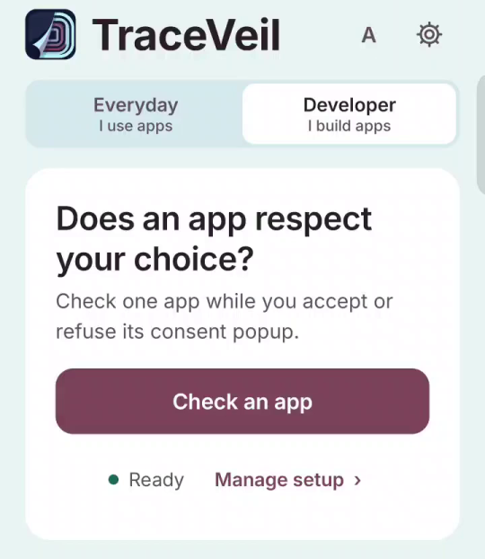
  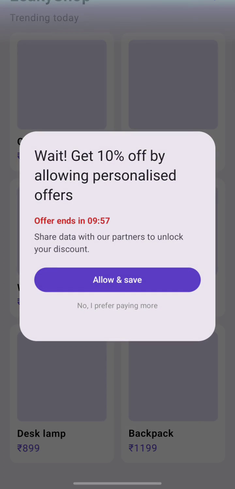
  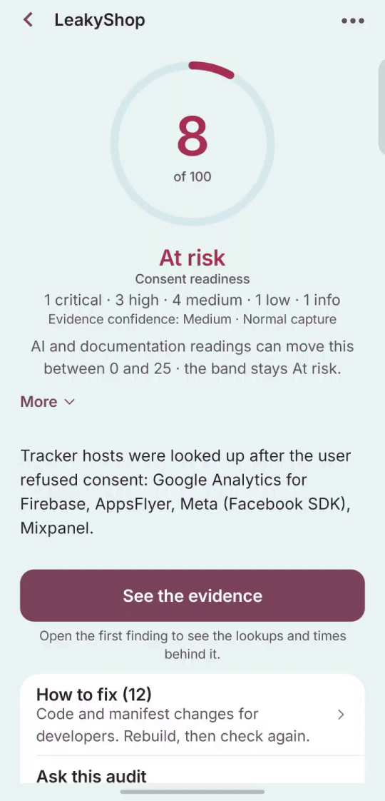
  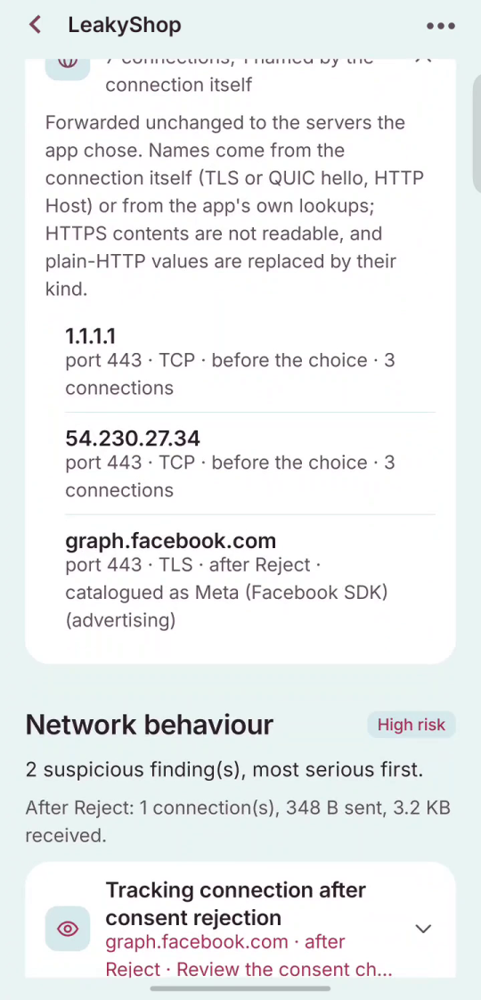
</p>

Team **Kernel Panic**: [nitya-prakash-pandey-2005](https://github.com/nitya-prakash-pandey-2005), [agrimsri](https://github.com/agrimsri), [yashviup](https://github.com/yashviup).
This repository builds on the DPDP X-Ray baseline written before the finale; [PROVENANCE.md](PROVENANCE.md) records the dates, the import scope and the use of AI coding assistance.

---

## Contents

- [The problem](#the-problem)
- [What TraceVeil does](#what-traceveil-does)
- [Tour of the app](#tour-of-the-app)
- [How a check works](#how-a-check-works)
- [What it checks](#what-it-checks)
- [How the score works](#how-the-score-works)
- [Legal lenses](#legal-lenses)
- [Safe on real apps](#safe-on-real-apps)
- [For developers: CLI, CI gate and signed evidence](#for-developers-cli-ci-gate-and-signed-evidence)
- [On-device AI](#on-device-ai)
- [Architecture](#architecture)
- [Getting started](#getting-started)
- [Results measured on a real phone](#results-measured-on-a-real-phone)
- [Privacy of TraceVeil itself](#privacy-of-traceveil-itself)
- [Limitations](#limitations)
- [Roadmap, including certification](#roadmap-including-certification)
- [Documentation](#documentation)
- [Licence and attributions](#licence-and-attributions)

---

## The problem

Privacy law is tightening worldwide. India's DPDP Act 2023 applies in full from **13 May 2027**, and the EU (GDPR and ePrivacy), the UK, California, Brazil and Singapore already enforce similar consent rules. The common rule: **saying no must be as easy as saying yes, and the company must be able to prove the user's choice was honoured.**

Most apps are not ready for that proof. Analytics, ads and attribution SDKs start contacting their servers as soon as the app opens: often before the consent screen appears, sometimes after the user taps "Reject all". Developers rarely intend it; the consent screen and the SDK setup are written separately and nobody tests them together.

| Existing approach | What it misses |
|---|---|
| Network proxy | Needs a laptop, a certificate and an expert; many apps reject the certificate |
| Static scanner | Lists SDKs, but not **when** they fire relative to the consent choice |
| Cloud scanner | Needs your build and its traffic uploaded to someone else |
| AI agent (code or screen) | Reads code or pixels; tracking happens in the network and inside closed SDKs, and a chat answer is not evidence |

Published research shows the scale: in a study of 1,201 Android apps, 71.3% contacted tracker hosts at launch before any tap and only 9.9% asked for consent (Kollnig et al., SOUPS 2021).

## What TraceVeil does

TraceVeil runs the app under test on a real phone, records every lookup and connection that one app makes **on the same clock as the consent tap**, and turns that evidence into findings, a score, the SDK responsible, the fix and a signed export.

- **For developers:** which SDK broke the user's choice, the code change, a re-check, signed evidence per release, and a CI gate that fails the build.
- **For users:** "Does this app respect my No?" in English or Hindi; a check before installing an APK; an alert for each new app; a website check.
- **No root, no certificate, no upload, nothing decrypted.** Everything runs on the phone.

## Tour of the app

All screenshots are from the current build on a retail phone (11 Oct 2026). LeakyShop is our own test app (see [below](#the-leakyshop-test-app)).

### Start a check

| Home | Trust and controls | The check sheet |
|:---:|:---:|:---:|
|  | 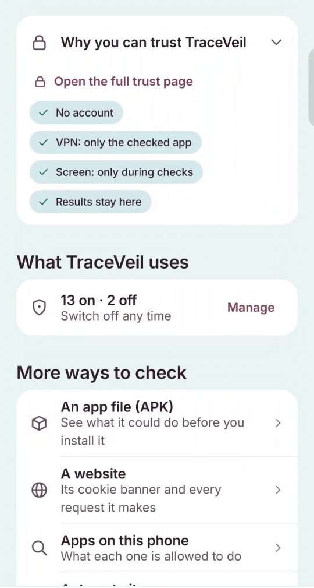 | 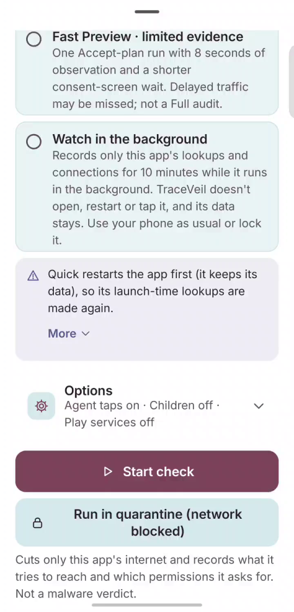 |
| Everyday mode ("I use apps") or Developer mode ("I build apps"); setup status in one line. | Why you can trust TraceVeil, every setting it uses (with a switch), and more ways to check: an APK, a website, the apps on this phone. | Full (three runs), Quick, Fast Preview or **Watch in the background**. Clearing an app's data is never on by default. |

### Watch the app being tested

| Live check | The consent popup | After "Reject" |
|:---:|:---:|:---:|
| 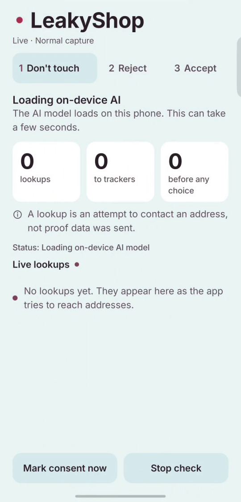 | 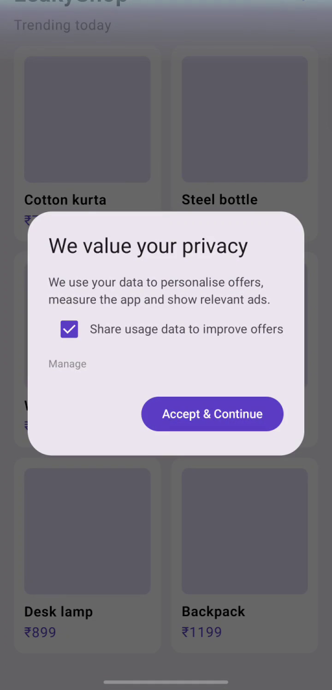 |  |
| Three runs: don't touch, Reject, Accept. Lookups, trackers and "before any choice" are counted live. | LeakyShop's popup: a pre-ticked box and no Reject button on the first screen. | The popup comes back seconds after Reject with a countdown: nagging and false urgency, recorded as evidence. |

### Read the result

| Score | Findings | Which SDK, dark patterns, Play label |
|:---:|:---:|:---:|
|  | 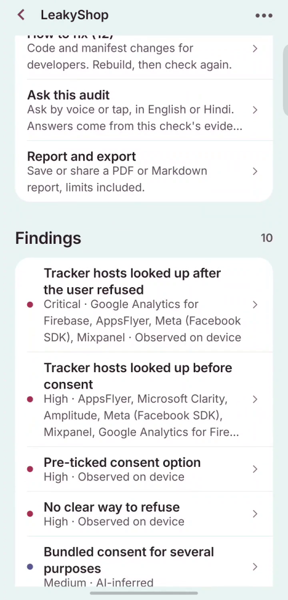 | 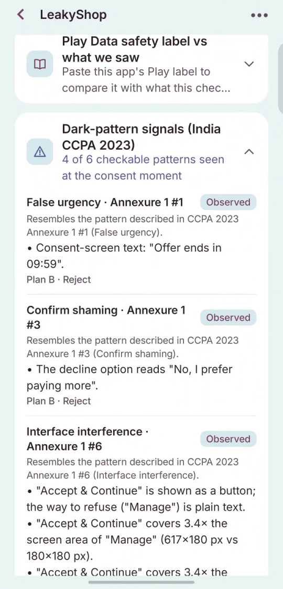 |
| 8 · At risk, with the severity mix and a robustness line showing how far AI readings could move it. | Each finding with its evidence level (observed on device, or AI-inferred) and the trackers involved. | Dark-pattern signals from India's 2023 guidelines, and the developer's Play Data safety answers compared with what the app did. |

### Beyond DNS

| Connections | Network behaviour | Score range, not "Inconclusive" |
|:---:|:---:|:---:|
|  | 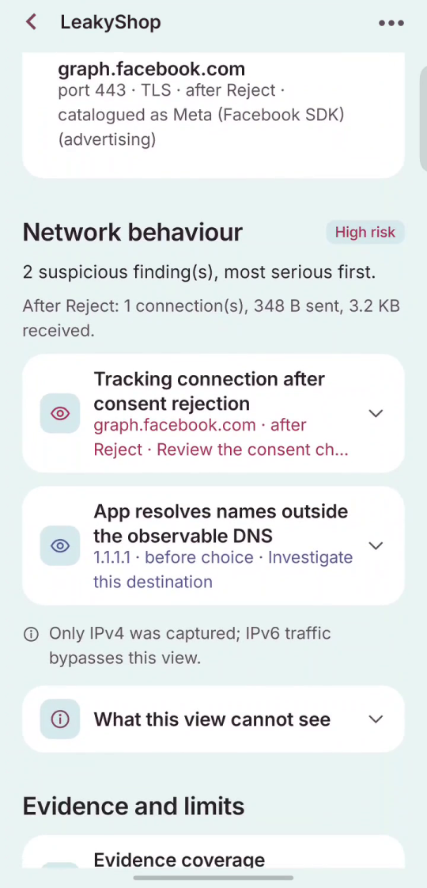 | 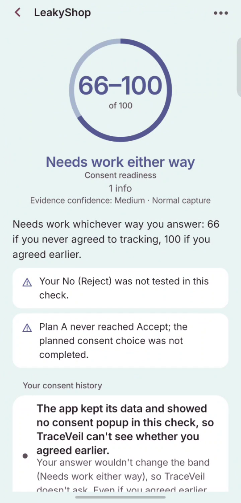 |
| Every connection of the checked app; server names are read from the encrypted connection's opening message. | "Tracking connection after consent rejection: graph.facebook.com", and the app's own private DNS flagged. | When the app kept its data and earlier consent can't be seen, TraceVeil scores both possible answers: "66–100 · Needs work either way". |

### Before install, AI, websites, evidence

| Before you install | On-device AI, in Hindi | Website check |
|:---:|:---:|:---:|
| 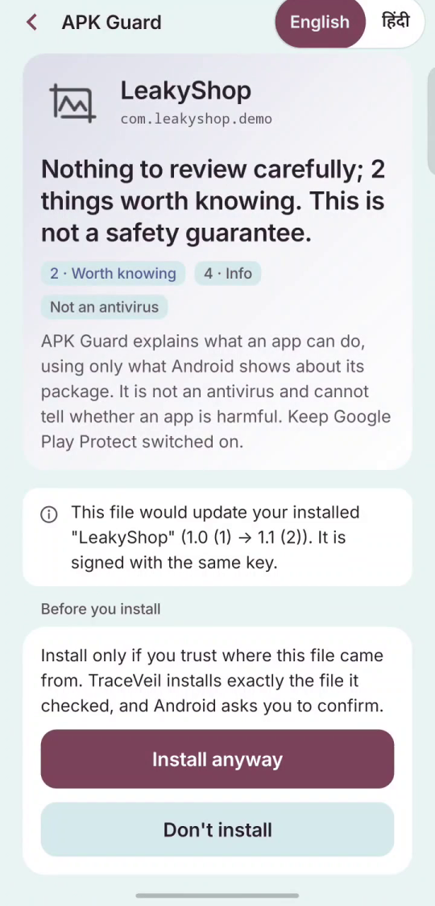 | 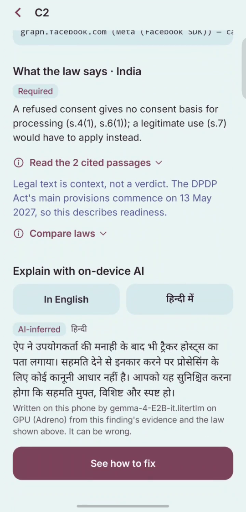 | 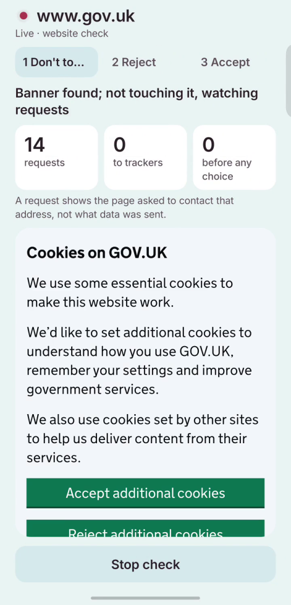 |
| Open any APK with TraceVeil: what it can do, the SDKs in its code, who signed it, then Install anyway or Don't install. | Gemma explains a finding in Hindi on the phone's GPU, labelled AI-inferred, next to the law it relies on. | TraceVeil's own emptied browser finds the cookie banner, refuses and accepts it, and records every request. |

| Website result | What TraceVeil uses | Signed export |
|:---:|:---:|:---:|
| 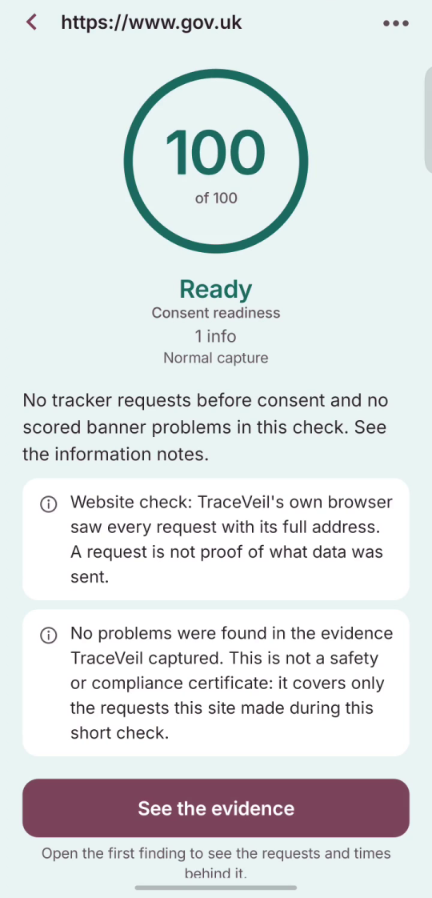 | 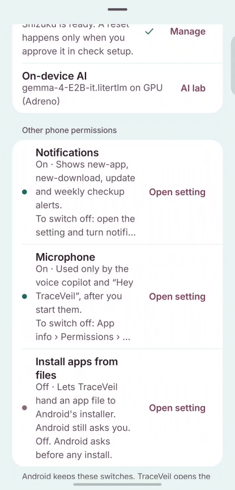 | 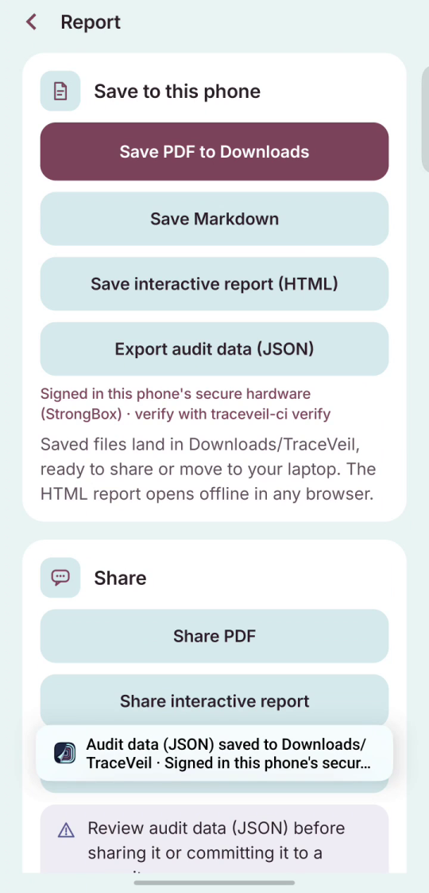 |
| GOV.UK: no tracker requests until Accept, 100 · Ready. | Every permission and background job, each with a way to switch it off. | "Signed in this phone's secure hardware (StrongBox) · verify with traceveil-ci verify". |

## How a check works

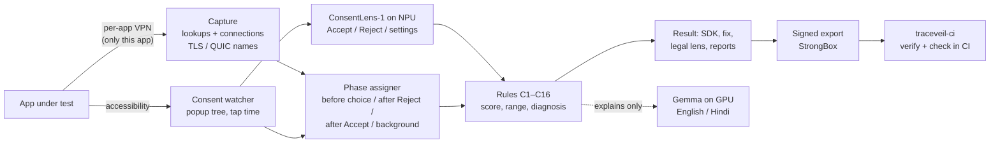

A **Full check** runs three plans: **don't touch** (25 s), **Reject** (15 s after the tap) and **Accept** (15 s), each followed by a short background window. TraceVeil can tap Accept and Reject itself, or ask you to.

The key ideas:

- **Per-app capture without root.** Android's `VpnService` routes only the app under test. Its DNS lookups are relayed to the network's resolver and its connections are forwarded unchanged through protected sockets. Nothing is decrypted.
- **Beyond DNS.** Server names are read from TLS ClientHello and QUIC Initial packets (RFC 9001), connections reached without a lookup are listed, and plain-HTTP requests are checked for personal-data fields (names only, values never kept).
- **One clock.** The accessibility watcher records the exact moment of the Accept or Reject tap; every network event is placed before or after it.
- **Observed facts win.** Deterministic checks on the accessibility tree decide; AI readings are labelled, weighted half, and shown separately.
- **Fresh starts only with permission.** With [Shizuku](https://shizuku.rikka.app/) TraceVeil can restart an app (data kept) or, for a confirmed test app, clear it.

## What it checks

| Check | What it means |
|---|---|
| **C1** | Tracker hosts looked up before any consent choice |
| **C2** | Tracker hosts looked up after the user refused |
| **NC** | Trackers contacted and no consent screen seen |
| **C3** | A consent option is pre-ticked |
| **C4** | No clear way to refuse (or refusal hidden behind "Manage") |
| **C5** | One button bundles several purposes |
| **C6** | The notice doesn't itemise the data or purpose |
| **C7** | No visible way to withdraw consent |
| **C8** | Notice offered only in English |
| **C9** | Tracking in a child-facing app |
| **C10** | Device identifiers likely shared before consent (*inferred*) |
| **C11** | Tracker reached through an alias name (CNAME cloaking) |
| **C12** | Tracker hosts contacted while the app was in the background |
| **C13** | SDK data collection on by default in the app's manifest |
| **C14** | Android permission requested before any consent screen or notice |
| **C15** | Consent screen shows no privacy-policy link or text |
| **C16** | Personal data in an unencrypted (HTTP) request |
| **U1 / S1** | Consent history unknown (app kept its data) · same-company servers (first-party) |
| **V0 / V1** | Too little seen to judge (never a clean pass) · some lookups may be hidden |
| **W1 / W2** | Websites: tracking cookies stored before consent · after refusal |

Each finding is either **observed** on the device or **inferred** (from SDK documentation or AI review). A lookup shows an attempt to contact a host, not proof of what was sent.

Also reported, outside the score: **dark-pattern signals** from India's 2023 Guidelines for Prevention and Regulation of Dark Patterns (false urgency, confirm-shaming, interface interference, nagging), the **Play Data safety label** comparison, and **which SDK** caused each finding (matched by host and found in the app's own code).

## How the score works

```
score = 100 − Σ weight(finding)        Critical 30 · High 15 · Medium 8 · Low 3 · Info 0
                                       an AI-inferred finding counts half
Ready      85–100 and no High or Critical problem observed on the phone
Needs work 60–84
At risk    below 60
```

- **Deterministic:** the same evidence always gives the same score. All **629,856** combinations of findings were enumerated to check that the score and bands behave as documented ([SCORING_SCIENCE.md](docs/SCORING_SCIENCE.md)).
- **Robustness line:** how far AI-inferred findings could move the score in either direction.
- **Unknown consent history:** a score **range** under both possible answers; if both give the same band, that band is the verdict, otherwise the person is asked one question.
- **Too little seen (V0):** inconclusive with a diagnosis of the likely cause and the one fix to try, never "clean".

## Legal lenses

The evidence is the same everywhere; a lens reads it against one law and marks each check **Required**, **Context** or **Not applicable**, with the cited text.

| Lens | Law |
|---|---|
| India | DPDP Act 2023 and DPDP Rules 2025 (main provisions from 13 May 2027, so findings describe readiness) |
| EU / EEA | GDPR and ePrivacy Directive Art. 5(3) |
| UK | UK GDPR and PECR reg. 6 |
| California | CCPA as amended by the CPRA |
| US children | COPPA (16 CFR Part 312) |
| Brazil | LGPD and ECA Digital |
| Singapore | PDPA 2012 |
| Global baseline | Good practice, not law |

The mapping is data in `core/src/main/resources/law/`; passages carry their source URL and retrieval date. `traceveil-ci check --profile <id>` applies a lens in CI. Findings are a technical assessment, **not legal advice**.

## Safe on real apps

- **Never clears an app's data unasked.** Quick and Preview keep data; only a Full check clears, and for any app other than the demo apps that needs a confirmation naming the app.
- **Restart safeguard.** Before restarting, TraceVeil checks whether the app runs an accessibility service, a VPN, a keyboard, a device-admin role, a foreground service or a notification listener, and by default checks without restarting.
- **Watch in the background.** For quiet apps or apps behind a sign-in screen: 5, 10 or 30 minutes of capture with no launch, no tap and no restart.
- **Diagnosis instead of a bare "unknown":** Private DNS, another VPN, a locked phone, a crash, a sign-in wall or an app that was already running are named, each with the one thing to try.

## For developers: CLI, CI gate and signed evidence

### `traceveil-ci` (Kotlin/JVM, `cli/`)

```bash
./gradlew :cli:installDist
CI=cli/build/install/traceveil-ci/bin/traceveil-ci

$CI run    --package com.example.app --apk app-beta.apk --mode full --require-signature   # hands-free on a USB phone
$CI check  bundle.json --policy docs/ci/traceveil-policy.json --profile india --format sarif
$CI diff   before.json after.json        # what changed between releases
$CI verify bundle.json                   # hardware signature: VERIFIED / NOT VERIFIED
```

Exit codes: `0` pass, `1` policy violation, `2` error. The composite GitHub Action in [`.github/actions/traceveil-gate`](.github/actions/traceveil-gate/action.yml) re-checks bundles, uploads SARIF to code scanning and fails the step on a violation ([CI_MODE.md](docs/CI_MODE.md), [RUNNER.md](docs/ci/RUNNER.md)).

### `traceveil` (Python, `src/traceveil`)

```bash
pip install traceveil          # Python 3.11+ and adb on PATH
traceveil doctor               # phone, debug build, permissions
traceveil audit --apk app.apk  # install, audit, save report.json
traceveil sdks  --apk app.apk --report report.json   # SDKs in the APK vs. seen live
traceveil lens  --report report.json --lens eu
```

Commands: `doctor`, `env`, `init`, `audit`, `watch`, `fix`, `lens`, `sdks`. See [tools/README.md](tools/README.md).

### Signed evidence

Each JSON export is signed with a key created inside the phone's secure hardware (StrongBox, or the TEE where there is none) and carries an Android Key Attestation chain. `traceveil-ci verify` checks it offline; change one byte and it fails ([SIGNED_EVIDENCE.md](docs/SIGNED_EVIDENCE.md)). Over many releases this becomes an audit trail: tested, fixed, re-tested.

### TraceVeil Console

A local-first dashboard in [`console/`](console/README.md): drop exported JSON files to get a portfolio view, consent timelines, release comparison and a policy editor. Data never leaves the browser.

## On-device AI

| Model | Where it runs | Job |
|---|---|---|
| **ConsentLens-1** (our own, 146 KB, INT8) | Hexagon NPU via Qualcomm QNN, 11 of 11 ops delegated | Reads consent buttons: Accept, Reject, settings |
| **Gemma 4 E2B** (`gemma-4-E2B-it.litertlm`) | GPU via LiteRT-LM | Explains findings in English or Hindi; answers "Ask this audit" with the law passage it relies on |

Neither model decides a finding or the score. TraceVeil works without Gemma (screen checks then use the accessibility tree only). Gemma loads on demand and closes itself after 10 minutes unused. Models are not bundled; copy one into the app's models folder:

```bash
adb push gemma-4-E2B-it.litertlm /sdcard/Android/data/com.dpdpxray.app/files/models/
```

## Architecture

```
├── core/        Pure Kotlin library: capture parsing, rules, score, lenses, reports (no Android)
├── app/         Android app (Jetpack Compose): capture, watcher, audits, AI, UI
├── cli/         traceveil-ci: check, diff, verify, run (Kotlin/JVM)
├── src/         traceveil Python CLI
├── console/     TraceVeil Console (local web dashboard)
├── leakyshop/   Test app with leaky, fixed and 1.1 flavours
├── riskdemo/    Harmless TEST app with risky-looking signals, for APK Guard
└── ml/          ConsentLens training and evaluation
```

| `core` package | Responsibility |
|---|---|
| `dns`, `netcapture` | DNS codec; user-space relay, TLS / QUIC / HTTP readers, flow tracking |
| `trackers`, `apk` | Tracker catalogue (48 entities); SDK signatures in an APK's DEX |
| `consent`, `screen` | Consent lexicon (English, Hindi, Kannada); screen auditor, dark-pattern scanner |
| `rules` | Rules C1–C16, score, robustness, consent-history range, visibility diagnosis |
| `law`, `dpdp` | Legal lenses, sourced passages, BM25 citations |
| `web` | Website-check evidence and rules |
| `evidence` | Signature format and offline Android Key Attestation verifier |
| `report` | JSON (`traceveil.audit.v1`), Markdown and HTML reports |

| `app` package | Responsibility |
|---|---|
| `capture` | `XrayVpnService` (per-app tunnel), relay, quarantine sinkhole |
| `consent` | `ConsentAccessibilityService`: popup detection, taps, permission dialogs |
| `audit` | `AuditOrchestrator`, restart safeguard, background watch, diagnosis |
| `apkguard`, `autoguard` | Check before install, new-app and download alerts, Update Watch |
| `webcheck` | Website check in TraceVeil's own WebView |
| `ai` | LiteRT-LM (Gemma) and ConsentLens on the NPU |
| `evidence`, `report` | Hardware signing; PDF, HTML, Markdown and JSON export |
| `controls`, `trust` | Every setting with its switch; the Trust screen |

**Tech stack:** Kotlin 2.4, Jetpack Compose (Material 3), coroutines, kotlinx.serialization; LiteRT-LM; Qualcomm QNN; Shizuku API; Android `VpnService`, `AccessibilityService`, Key Attestation, `WebView`; Android Gradle Plugin 9, compileSdk 37, minSdk 29 (Android 10+), targetSdk 36.

## Getting started

**Requirements:** an Android 10+ phone (arm64 recommended); JDK 17 and the Android SDK (platform 37) to build. Optional: Shizuku for restarts and fresh starts; a Gemma model for explanations.

```bash
git clone https://github.com/agrimsri/IQOO-Kernel-Panic.git
cd IQOO-Kernel-Panic

./gradlew :core:test :app:testDebugUnitTest :cli:test          # 2,235 JVM tests
PYTHONPATH=src python -m pytest tools/tests                      # Python CLI tests
./gradlew :app:assembleDebug                                     # TraceVeil
./gradlew :leakyshop:assembleLeakyDebug :leakyshop:assembleFixedDebug

adb install app/build/outputs/apk/debug/app-debug.apk
adb install leakyshop/build/outputs/apk/leaky/debug/leakyshop-leaky-debug.apk
```

**One-time setup** (Home → Manage setup lists each item with a one-tap fix): allow the VPN; turn on the TraceVeil consent watcher in Accessibility; optionally start Shizuku; set Private DNS to Off while checking. Every one of these can be switched off again from Home → *What TraceVeil uses*.

### The LeakyShop test app

`leakyshop/` is a small shop built to exercise every check. It contains **no real SDKs**: it makes the same lookups AppsFlyer, the Meta SDK, Firebase and Mixpanel make, and sends no data.

| Flavour | Behaviour | Result |
|---|---|---|
| **leaky** | SDKs start at launch, pre-ticked box, Reject hidden behind "Manage", tracking after Reject, the popup returns after Reject | **21** with rules alone, **8 · At risk** with AI-read notice findings |
| **leakyV11** | The 1.1 update fixes refusal | Update Watch: **8 → 53**, "Fixed: C2, C4" |
| **fixed** | Waits for consent, equal Accept and Reject, off-by-default toggles, three languages | **100 · Ready** |

## Results measured on a real phone

Measured on a retail phone, 10–11 Oct 2026.

| Check | Result |
|---|---|
| LeakyShop, leaky build (Full check) | 8 · At risk: trackers before the choice and after Reject; graph.facebook.com contacted after Reject, read from the TLS server name |
| LeakyShop, fixed build | 100 · Ready |
| LeakyShop 1.0 → 1.1 | Update Watch 8 → 53, "Fixed: C2, C4" |
| GOV.UK (website check) | 100 · Ready: no tracker requests until Accept |
| A large news website | 70 · Needs work: 12 trackers before any choice, no banner |
| A popular mobile game (data kept) | 65–99 · Needs work either way; two ad networks contacted in the background |
| Hands-free runner | 7 of 7 policy rules passed, signature verified, 122 s |
| ConsentLens-1 | 11 of 11 ops on the NPU |
| Battery | about 1.16 mAh for one full check (Android's batterystats estimate) |

## Privacy of TraceVeil itself

- **No account, no TraceVeil server, no analytics, ads or crash-reporting SDK.** A unit test scans the code for any network path not listed on the Trust screen.
- **The VPN carries only the checked app, only during a check.** Its lookups and connections are forwarded unchanged; nothing is decrypted.
- **The consent watcher ignores every event** unless a check or quarantine run you started is going.
- **Results stay on the phone.** Android cloud backup is off; "Back up my checks" writes one file you control, refused on restore if edited.
- **Website checks** open only the address you type, in TraceVeil's own browser, emptied before and after.

## Limitations

- **Contents are not read.** TraceVeil sees who an app contacts and when, not what it sends inside encrypted traffic; payload claims are always labelled inferred.
- **IPv6 is not relayed**, and QUIC versions other than v1 stay address-only.
- **Server-side forwarding** through the developer's own backend is not visible from any phone.
- **Legitimate uses:** some processing may rely on a basis other than consent; TraceVeil flags the behaviour, and whether an exemption applies is a legal judgement.
- **One run, one phone, one moment:** a pass describes what was observed, not a compliance certificate.

## Roadmap, including certification

| When | Step | How |
|---|---|---|
| Now | Signed, repeatable evidence | StrongBox-signed exports, offline verification, deterministic rules, open tests |
| 0–3 months | Map to **ISO/IEC 29184** | Map C1–C16 to the standard for online privacy notices and consent; publish the test method; reproduce 21 / 8 / 100 on three phones |
| 3–9 months | Audit partners | Pilots with CA and audit firms, including CERT-In empanelled auditors; they sign the opinion, TraceVeil supplies the evidence |
| 6–12 months | Accredited test method | Run the method in an **ISO/IEC 17025**-accredited lab; review TraceVeil itself against OWASP MASVS and ISO/IEC 27701 |
| 12–24 months | Platform recognition | Apply as an App Defense Alliance (MASA) lab; add lenses as countries publish rules |

Certified evidence shows a developer did the work: tested every release and fixed what was found. It does not replace the company's own legal responsibility.

Also next: more consent-lexicon languages (Tamil, Telugu, Bengali, Marathi), a signed offline tracker-catalogue update channel, and checks for AI agents on phones.

## Documentation

| Topic | Document |
|---|---|
| Scoring, exhaustive checks, sensitivity | [SCORING_SCIENCE.md](docs/SCORING_SCIENCE.md) |
| Network capture beyond DNS | [NETWORK_CAPTURE.md](docs/NETWORK_CAPTURE.md) |
| Website check | [WEB_CHECK.md](docs/WEB_CHECK.md) |
| Check before install | [CHECK_BEFORE_INSTALL.md](docs/CHECK_BEFORE_INSTALL.md) |
| Real-app tests and diagnosis | [REAL_APP_TESTS.md](docs/REAL_APP_TESTS.md) |
| Dark patterns · Play label | [DARK_PATTERNS.md](docs/DARK_PATTERNS.md) · [PLAY_LABEL_CHECK.md](docs/PLAY_LABEL_CHECK.md) |
| Signed evidence | [SIGNED_EVIDENCE.md](docs/SIGNED_EVIDENCE.md) |
| CI mode · Runner | [CI_MODE.md](docs/CI_MODE.md) · [RUNNER.md](docs/ci/RUNNER.md) |
| Release and licences | [RELEASE.md](docs/RELEASE.md) · [LICENSES_FOR_SALE.md](docs/LICENSES_FOR_SALE.md) |

## Licence and attributions

- **Code:** [MIT License](LICENSE) © 2026 Nitya Prakash Pandey.
- **LiteRT-LM:** Apache 2.0 · **Shizuku API:** MIT · **Qualcomm QNN runtime:** Qualcomm licence, notice in the app's Open-source notices.
- **Gemma models:** Gemma Terms of Use (not bundled).
- **Map data:** DB-IP Lite (CC BY 4.0), Natural Earth (public domain).
- **Legal texts:** DPDP Act and Rules from Government of India publications; other lenses quote official publishers with URL and retrieval date in `core/src/main/resources/law/passages.json`.

See the [attribution register](ATTRIBUTIONS.md) for licence evidence.

> TraceVeil is a technical assessment tool. Its findings are not legal advice.
